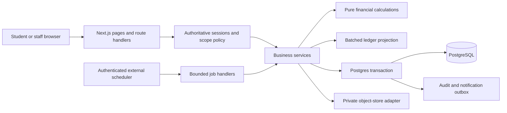

# Architecture and data model

Implementation snapshot: 2026-11-16. The master prompt is the requirement source; the referenced PDF was unavailable. This document describes code present, not production certification. See [traceability](traceability.md) and [verification log](test-results.md) for current gates and measured results.

## Boundaries and request flow

- `src/app` contains App Router server components and API adapters. Small client components implement forms, review/call interactions and CSRF-aware fetches. Server components call services directly rather than making internal HTTP requests.
- `src/server/http.ts` supplies JSON validation, request IDs, private headers and a common error taxonomy. Dynamic route params are awaited (Next 16).
- `src/server/auth/staff.ts` resolves opaque session tokens against active staff and current `authVersion`, scopes and expiry. Mutations require the session CSRF header and same-origin checking. Sensitive services re-read the principal and current capabilities/scopes inside their transaction through `src/server/auth/fresh.ts`; the earlier F-01–F-13 review findings are resolved in current source. See the current test-status section in [traceability](traceability.md), not the historical audit snapshots below it, for current verification.
- `src/server/auth/student.ts` normalizes NIC, matches a keyed digest + public intake, checks active student/enrolment/intake/programme and binds a session to exactly one enrolment. No student password/OTP/self-registration is introduced. Remembered devices use hashed opaque tokens and masked suggestions.
- Staff can copy/open `/join/<intake UUID>` from an intake detail. This dynamic private/no-store page is limited to active public intakes and programmes, displays the fixed course/intake and accepts NIC only; a stored last-course choice cannot override its intake. An unavailable link and an ineligible NIC do not reveal record existence.
- `src/server/services` implements admission/fee/exemption/withdrawal accounting, receipts/reviews, directory, governance, Trash, follow-ups, reports and imports. `src/domain/finance.ts` is pure authoritative money math; `src/server/services/ledger.ts` projects database facts into those calculations.
- Fee-plan revisions have an explicit selected-enrolment preview/apply path. It locks/reloads each ledger, hashes the preview, permits amount changes only when schedule structure is identical, rechecks hashes before an all-or-nothing, idempotent transaction, and audits each change.
- Invalid/missing-identity import rows are preserved in `identity_resolutions`. The Super Admin-only resolution service exposes sanitized previews and atomically creates the corrected student/enrolment/optional opening schedule while marking the staged row resolved; it never silently merges people or replaces source evidence.
- `src/db/client.ts` owns the postgres-js pool and `withTx`; `src/db/schema.ts` owns persistence. SQL migrations under `drizzle` add constraints/triggers that the schema DSL cannot express. Environment configuration and private storage stay server-side.

## Data model

These are the actual table groups from `src/db/schema.ts`. UUIDs identify mutable entities and events; business dates use SQL DATE and instants use `timestamptz`. Money columns use BIGINT mapped to JS numbers; callers must keep values within safe integer bounds.

| Group | Tables | Relationships and invariant |
|---|---|---|
| Staff governance | `governance_lock`, `staff_accounts`, `staff_scopes`, `staff_invitations`, `staff_sessions` | Singleton governance row serializes active Super Admin changes. Exactly two role enums. Scope grants target a programme and optionally one intake; null intake means all its intakes. Invitations/sessions store token hashes, expiry and revocation. |
| Catalogue | `programmes`, `intakes` | Programme has branding/public/state/Trash metadata; intake belongs to one programme and has unique code/label, dates and optional banner override. |
| Person and identity | `students`, `identity_resolutions` | One person across many enrolments. Unique reference and non-null NIC lookup digest. NIC is AES-GCM ciphertext + HMAC lookup + masked display. Invalid legacy identity rows are quarantined instead of inventing an identity. |
| Schedule templates | `fee_plan_versions`, `fee_plan_items` | Immutable version with LKR currency; one current version per intake. Ordered items carry explicit date, fee component and minor-unit amount. |
| Admissions | `admissions`, `admission_events` | Applicant belongs to intake; acceptance links student and one enrolment. Events preserve state transitions. Accepted enrolment link is unique. |
| Enrolment | `enrolments`, `instalments` | Unique student/intake, fee-plan version and terms snapshot. Instalments copy template items and remain stable after template edits. States ACTIVE/COMPLETED/WITHDRAWN/INACTIVE are separate from person status. |
| Adjustments/waivers | `charge_adjustments`, `exemption_awards`, `exemption_applications` | Signed charge history; reasoned awards of FIXED minor units or PERCENT basis points; applications and reversal markers bind individual instalments. |
| Evidence | `upload_intents`, `receipt_assets`, `payment_submissions` | Intent binds random object key, enrolment, size/type and expiry. Asset records hash/metadata/validation/scan status. Submission has target, claimed amount, transfer date, replacement predecessor, status/version. Unique predecessor prevents competing replacement chains. |
| Review and ledger | `review_actions`, `payment_events`, `payment_allocations` | Unique decision per submission version. Receipt/historical/reversal events preserve cash history; allocations point to same-enrolment instalments and payment events through composite foreign keys. Reversals retain original facts. |
| Follow-up | `call_attempts`, `payment_promises`, `follow_up_tasks`, `business_holidays` | Attempts immutable and unique by operator/client ID. Promise targets have an allocation baseline and dated state. Tasks have business dedupe keys, owners, version and short leases. Calendar holidays are explicit. |
| Student credentials | `student_sessions`, `remembered_devices` | Hashed tokens, student + enrolment binding, CSRF and expiries; remembered device is revocable and not an identity verification factor. |
| Operations | `audit_events`, `notifications`, `outbox_events`, `job_runs`, `job_leases`, `idempotency_records`, `rate_limit_buckets`, `export_jobs` | Redacted append-only audit, deduplicated portal notifications/outbox, observable jobs, transaction replay records and distributed Postgres rate limits. `export_jobs` stores queued CSV generation, expiry and current-authority fingerprint. A synchronous export endpoint also remains available. |

Historical foreign keys restrict deletion. `drizzle/0001_integrity.sql` blocks UPDATE/DELETE on audit, review actions, call attempts, payment events and charge adjustments; allocation amounts and links are immutable, reversal markers can be set once, and insertion checks allocation currency against its instalment/payment. These controls are not cryptographic tamper-proofing against database operators.

## Ledger and money

For each instalment: `net = original charge + signed adjustments - active exemptions`; `remaining = net - active allocations`. Enrolment credit is verified receipt/historical events less reversals less active allocations. The pure domain throws on negative obligations/remaining/credit instead of hiding inconsistencies with clamping.

`loadLedgers(tx, ids)` sorts/de-duplicates IDs, loads instalments and grouped adjustments/exemptions/allocations/pending claims/receipt events with a fixed number of queries, then constructs per-enrolment views. There is no persisted mutable balance column. Due-now/overdue states use the current Colombo date without waiting for a nightly job. Pending/rejected claims are not collected cash; exemptions reduce obligations without creating receipts. The newer `services/reports/balances.ts` computes equivalent scoped SQL aggregates, aggregating each child table before joining to avoid financial fan-out; it validates negative balances and safe integers. `getCommandCentreMetrics` now uses this SQL summary instead of hydrating every instalment in JavaScript. Keep equivalence tests against the domain projection when changing either implementation.

Approval atomically writes a review action, verified event, allocations, submission state/version, audit and notification/outbox. Explicit spill-over fills earliest remaining instalments after the selected one; excess stays as enrolment credit. Credit application retains event attribution and does not count as new collection. Waivers/withdrawals that reduce a paid obligation release excess allocations into credit. Undo/correction append reversals; dependency preview prevents quick undo from erasing later credit use. Withdrawal retains dues through its effective date, records future cancellations and unresolved refund consideration. Actual refunds are outside MVP.

## Concurrency and authorization

`withTx` retries SQLSTATE `40001` and `40P01` with bounded jitter (four retries by default). Locks and unique constraints remain authoritative; advisory UI leases reduce collisions only. Ledger locks use sorted enrolment/instalment order; critical operations check expected versions. Governance takes the singleton lock before account locks and rechecks the one-to-three active Super Admin invariant, including restore/acceptance/deactivation. Scope misses return NOT_FOUND to avoid existence disclosure.

Replay implementations are `src/server/idempotency.ts` and `services/governance/idempotency.ts`, with a follow-up replay helper. Keys bind an operation scope and payload digest; changed payloads return IDEMPOTENCY_MISMATCH. Fee-plan version creation and selected-enrolment application require idempotency keys and recheck current capability inside the transaction. Other mutation families still have specific exceptions; see the endpoint table, including admission creation, exemption revocation and some correction paths. Student finalization's fast replay currently returns the existing submission for an enrolment/key without comparing a changed payload. Treat that as a contract limitation.

## Evidence and integrations

Intent -> authenticated byte upload -> server finalization validates actual stored bytes, magic/type/decode/dimensions/PDF limits and transfer date; finalization generates sanitized WebP previews for images and persists asset/submission atomically. Authenticated student/staff routes recheck ownership/scope before reading private bytes. Staff PDFs use an app-owned canvas reader with page navigation, zoom and rotation. PDF.js 6.5.438 and its worker/fonts/maps/WASM assets are pinned and self-hosted; `scripts/prepare-pdfjs.mjs` prepares the allowlisted assets during installation/build. Private bytes are fetched with same-origin credentials and no-store, without client storage or external services; evidence responses retain their strict sandbox CSP. Exact hashes and references flag duplicates for human review; perceptual similarity is not implemented.

`src/server/storage.ts` provides a development local filesystem store outside public and an S3-compatible adapter (`src/server/storage/s3.ts`). The adapter passed tests against a dedicated ephemeral MinIO service; no production bucket, credentials, IAM policy, encryption, versioning or backup configuration was provisioned. The local store refuses production by default. `src/server/malware.ts` implements the ClamAV `zINSTREAM` client and finalization fails closed on configured scanner errors; protocol tests use a local harness, while a real daemon, signatures and network remain operator setup. Portal notification rows are real. Email/SMS providers remain disabled; outbox marks those channels SKIPPED rather than claiming delivery.

## Caching and jobs

`next.config.ts` disables cache components and sets private no-store on entry, staff/student pages and protected API paths. `http.ts` does the same for wrapped responses. Public course metadata has a 60-second public TTL with stale-while-revalidate; static build assets, fonts, banners, brand and icons are service-worker allowlisted by `public/sw-policy.js`. Navigations and other APIs are network-only; the public offline shell contains no financial records. Real browser/back-forward/CDN verification is still required; a policy unit test is not deployed cache proof.

| Job | Trigger/implementation | Coordination and limits |
|---|---|---|
| Follow-ups | GET/POST `/api/cron/followups`, `services/followups/jobs.ts` | Bearer auth, five-minute lease, persistent queue/promise/maintenance cursors, bounded 50-row batches, dedupe keys, run status/error visibility; drain while hasMore. |
| Trash purge | GET/POST `/api/cron/purge`, `services/trash/purge.ts` | 30-day deadline, row SKIP LOCKED, governance/public-media locks, referenced-asset protection, bounded batch and retryable failures. Financial history/tombstones remain. |
| Abandoned uploads | GET `/api/cron/uploads-cleanup` | Up to 200 expired intents after a 24-hour grace; attached evidence is never deleted. Job run records failure. |
| Outbox | GET `/api/cron/outbox` | Up to 200 due events; portal bookkeeping and non-portal SKIPPED. Current row-lock query is not held across an encompassing transaction; this is not a complete provider-delivery lease/backoff worker. |
| Reconciliation | Operator `scripts/reconcile.ts` | Read-only audit of every stored ledger, allocation and cash event. Dashboard balance/collection-rate comparisons use the same active, non-trashed intake/programme scope as reports; global cash-history checks remain global. No automatic accounting repair or scheduled reconciliation endpoint. |
| Exports | POST `/api/staff/exports`, GET `/api/staff/exports/[id]`, GET `/api/cron/exports`, `services/reports/export-jobs.ts` | Audited idempotent queue, fresh authorization at generation/delivery, owner-only access, role/scope fingerprint invalidation, SKIP LOCKED claims, bounded five-job worker, dependency retry backoff, private storage and 15-minute generated-file expiry. Synchronous `/api/staff/reports/export` also remains. CSV is still assembled fully in memory. |

`vercel.json` contains schedules; purge now supports GET as well as POST. No scheduler, Neon deployment, private S3 bucket or live external notification provider was provisioned here. Production integration details and backup/key procedures are in [scheduler/storage](scheduler-storage-setup.md) and [backup/restore](backup-restore-runbook.md).

## Fixture and performance boundaries

`scripts/seed.ts` is development-only, uses service transactions and receipt validation, and checks every seeded ledger plus scenario postconditions. It prints only explicitly synthetic login identifiers. Destructive reset requires `--reset` and retains the governance row while resetting its marker. `seed-perf.ts` requires a separate empty `_perf` database and inserts 10,000 students / 60,000 instalments in 250-person batches inside one transaction. `perf-check.ts` measures real service queries over 20 warm sequential runs; see [measured conditions/results](test-results.md). The first measurement used full JavaScript enrolment projections for metrics; the follow-up measures the SQL summary implementation. Drill-downs and synchronous reports still materialize result lists; page/query performance does not imply a bounded concurrent production workload.
